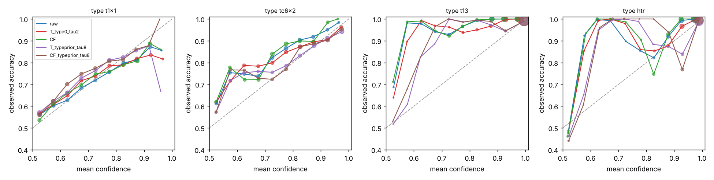
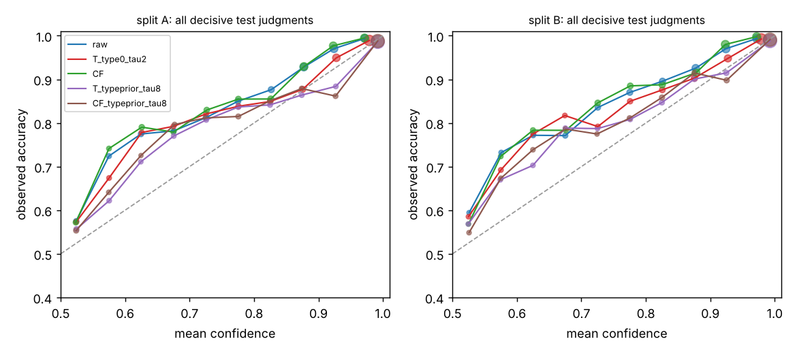
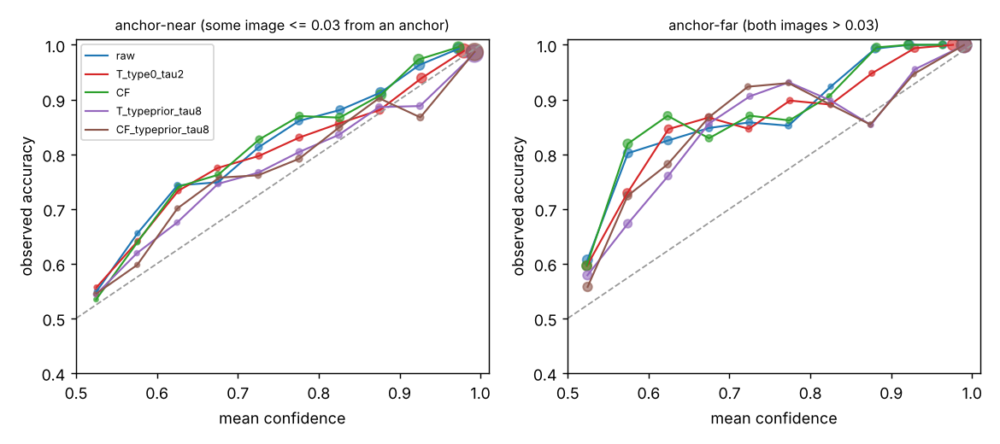

# Calibration of the Laplacian learner `lap3_k10_st4` (branch `claude/calibration-20261013`)

Every table in this file is generated by `cal_report.py` from the stored stage-1 cells (`new_directions/results/cal/*`); the text is hand-written. Same 168 pair groups as all earlier work (re-split with new seeds, **not new data**): p-values are optimistic; only the pre-registered confirmation (seeds 9150–9184, frozen in `PREREGISTRATION_CAL1.md` before any of its cells existed) counts as evidence; everything from seeds 9100–9119 is a development observation (selected on those seeds).

## 1. Answer
**Yes: the log-loss and the calibration of `lap3_k10_st4` can be improved substantially, and a pre-registered confirmation (35 new seeds, splits A and B, Holm over 16 tests) supports it — but the thing that is mis-calibrated is not what the task description assumed.**
- **The raw head is under-confident, not over-confident, for three of its four types** (RT13 about 3×, c(6x2) and HTR about 1.5× too flat; (1x1) slightly over-confident). The Laplacian penalty compresses score gaps; the graph-free learner `aw8_all_st2lr0.5` has the larger logits. The red-team finding that `lap3_k10_st4` is *worse in log-loss on RT13 and anchor-far judgments* than the graph-free learner is therefore a relative-scale effect: after per-type calibration the deficit disappears (§7), while the AUC / accuracy advantage stays (accuracy is invariant to any temperature; the pooled AUC lead shrinks a little because per-type temperatures also raise the AUC of the graph-free learner).
- **Pre-registered confirmations (CAL1, seeds 9150–9184).** Three of four frozen candidates met the success rule: **A1** per-type temperatures fitted only on the labelled budget by 5-fold (by pair group) out-of-fold logits with a ridge to T = 1 (log-loss −0.015 / −0.017, ECE −0.016 / −0.012, AUC +0.003; split A / B); **A3** the same centred on four constants fitted on development runs (log-loss −0.043 / −0.047, ECE −0.024 / −0.021, AUC +0.011 / +0.010); **A4** A3 applied to a cross-fit ensemble (final head + the 5 fold heads, logit average): log-loss −0.047 / −0.051, ECE −0.018 / −0.017, AUC +0.013 / +0.012, accuracy +0.004 / +0.002 — all with 4 of 4 Holm-significant tests and no loss in AUC or accuracy. The cross-fit ensemble alone (A2) improves log-loss slightly (−0.004) but not ECE (worse in B) and **fails** the rule. A global temperature, label smoothing, distance-weighted temperatures, far-from-anchor shrinkage and a post-hoc ties model do **not** help (development; recomputed on the confirmation cells, all but label smoothing — which was not run there — make log-loss *worse* than raw).
- **Anchor-far secondary endpoint:** the calibration gain is *larger* far from every anchor (A3 log-loss gain +0.061 / +0.073) than near one (+0.036 / +0.041); it is not an anchor-near artefact. After calibration the far and near strata have about the same log-loss in split B.
- **What A1 vs A3/A4 means for "labels inside the budget only":** A1 and A2 use only the labelled budget. A3/A4 additionally use four constants (RT13 0.293, HTR 0.630, c(6x2) 0.682, (1x1) 1.352) fitted on the labelled out-of-fold logits of *development* runs; they are as stable as a hyper-parameter (they match the confirmation seeds' own in-sample optimum, §6.1) but, like λ and the schedule, they were estimated on re-splits of the same 168 pair groups, so the result does not show that the constants transfer to a new growth run. Five to thirteen decisive labelled judgments per type are not enough for a within-run calibrator to find the type pattern on its own (A1 recovers about a third of A3's gain and slightly hurts (1x1)).
- **Part of the earlier log-loss story is a scale effect:** about a third (A) to a half (B) of the log-loss gain of the 4× schedule over `lap3_k10` disappears after the same calibration (development, §8.1); a learner-side fix (Laplacian penalty off for RT13) gives the same log-loss as post-hoc calibration but costs accuracy (§8.2).
- **Not confirmed / open:** transfer to new growth runs or another encoder (GPU_TASKS); calibration under distribution shift; whether a dedicated calibration set of fresh judgments would let the within-run calibrator close the gap to A3.


## 2. Setting
**Endpoint** (unchanged protocol): held-out decisive judgments of image-disjoint test groups, budgets 10/20/40/60 judgments on top of the 10 initial groups, splits A and B, confidence-weighted log-loss / accuracy and pooled AUC; new here: **ECE** (10 equal-width bins on the confidence of the predicted winner, confidence-weighted, pooled over a seed's label sets). The model's probability that image 1 wins is `sigmoid(d)`, `d = r_k(a) − r_k(b)` the own-type score gap.
**Label budget rule.** No label beyond the labelled budget is used by any calibrator: the validation groups of split A are never touched, the test labels are only used for scoring (unit-tested: every calibrated variant is invariant to the test labels). Calibrators work on *out-of-fold* logits of the labelled judgments: the labelled judgments are split into 5 folds by pair group; 5 heads are trained on 4 folds each (same learning rate / number of steps as the full head), and each labelled judgment is scored by the head that did not see its group. Only the decisive judgments (~20–50 per label set, **5–13 per type**) enter a calibrator.
**Variants.** `raw` (the registry learner `lap3_k10_st4`, verified identical); `T_glob` (one temperature); `T_type_tau{2,8,32}` (per-type temperatures shrunk to the global one); `T_type0_tau{0.5,2}` (per-type temperatures with a ridge towards T = 1); `T_typeprior_tau{2,8}` / `_fixed` (per-type temperatures centred on constants fitted on *other* development seeds' labelled out-of-fold logits — leave-one-seed-out in all development tables); `T_conf_*` (temperature depending on the distance of the judgment's images to the nearest anchor / labelled image / graph density); `shrink_far` (scores shrunk towards 0 far from every anchor); `Davidson` (Davidson's ties model fitted post hoc on all outcomes: decisive and tie); `ENS` (5 full-data heads averaged); `CF` (cross-fit ensemble: final head + the 5 fold heads averaged — free, since the fold heads exist anyway); `*_T` (variant followed by the global temperature); `ls0.1`, `ls0.25` (label smoothing in the Bradley–Terry loss, retrained). Definitions are in `nd_calibration.py`.

## 3. What the raw head's calibration looks like (development; seeds 9100–9119)
**The raw `lap3_k10_st4` is not uniformly over-confident; in absolute terms it is under-confident for three of the four types.** The temperature that minimises the test log-loss of the raw logits (a diagnostic, never a method), mean over label sets:

{{TABLE:oracle}}

(log T > 0: the raw head is over-confident and should be softened; log T < 0: it is under-confident and should be sharpened; RT13 and HTR judgments are answered correctly ≈ 97 % / 94 % of the time with small logit gaps.) The per-type scale pattern is the same in both splits and at every budget, so a single global temperature cannot fix it. **Mechanism (descriptive):** the Laplacian penalty pulls neighbouring images' scores together, i.e. it shrinks score gaps. Mean |d| of the own-type score gap on held-out decisive judgments (dev1 against the tuned graph-free learner `aw8_all_st2lr0.5`, same label sets): (1x1) 1.23 vs 2.05, c(6x2) 1.24 vs 2.20, RT13 2.08 vs 3.40, HTR 2.73 vs 2.85, while accuracy is higher for the Laplacian learner (0.731 / 0.837 / 0.973 / 0.945 vs 0.666 / 0.819 / 0.962 / 0.930). So the graph-free learner is the *over*-confident one, and the red-team observation that `lap3_k10_st4` is worse than `aw8_all_st2lr0.5` in log-loss on RT13 and on anchor-far judgments (§7) is a statement about the relative scale, not about over-confidence of `lap3_k10_st4`.

## 4. Development screens (seeds 9100–9119, leave-one-seed-out priors; positive = better than the uncalibrated `raw`)
Run `dev1` (draw 0: all variants, including the 5-head ensemble and label smoothing) and `dev2` (draw 1: the main variants again on different label sets of the same seeds).

{{TABLE:dev1_gain}}

`dev2` (second set of label sets, same seeds):

{{TABLE:dev2_gain}}

Reading (development only): (i) a single temperature does not work (it helps split A a little and hurts split B), because the types need opposite corrections; (ii) per-type temperatures are the working ingredient — fitted only on the labelled out-of-fold logits with a ridge to T = 1 they already give about +0.015 log-loss, centred on development constants about +0.035; the difference between the ridge-to-1 and the prior-centred versions is the information a within-run calibrator cannot get from 5–13 decisive judgments per type; (iii) the pooled AUC *rises* with per-type temperatures (+0.003 … +0.012) because the endpoint's AUC pools judgments of different types and the types' score scales are misaligned; accuracy is untouched by any temperature; (iv) the cross-fit ensemble helps AUC/accuracy a little (+0.002…+0.005) and log-loss by +0.002…+0.009, ECE not; (v) label smoothing makes log-loss and ECE worse (the head is not over-confident, so softening the targets hurts), distance-weighted temperatures and far-from-anchor shrinkage add nothing over the per-type constants, and the post-hoc tie model (Davidson) does not help the decisive endpoint.
Gain by budget (dev2; the gains do not shrink with the number of labels):

{{TABLE:budget_dev}}

## 5. Pre-registered confirmation (seeds 9150–9184, splits A and B; `PREREGISTRATION_CAL1.md`, frozen at commit ef0410d0f before any of these cells existed; run once)
Control = raw `lap3_k10_st4`; four frozen candidates (A1 `T_type0_tau2`: within-run per-type temperatures, ridge to 1; A2 `CF`: cross-fit logit ensemble; A3 `T_typeprior_tau8`: per-type temperatures centred on the development constants; A4 `CF_typeprior_tau8`: ensemble + A3 temperatures). Holm over the family of 16 (4 candidates × 2 splits × {log-loss, ECE}); every gain below is raw − candidate for log-loss and ECE (positive = better), candidate − raw for AUC and accuracy.

{{TABLE:confirm}}

**Verdicts under the pre-registered rule.** A1, A3 and A4 **succeed** (log-loss gain positive in both splits, all 4 of their 4 tests Holm-significant, AUC and accuracy not worse); A2 **does not** (log-loss tests significant, 2 of 4; ECE is not better in A and significantly *worse* in B). The expectation written in advance (ECE might keep candidates below the line; A2 alone changes log-loss little and not ECE) was half right: ECE did not keep any of the temperature candidates below the line, and A2 behaved as predicted.
**Effect sizes.** Raw log-loss 0.353 (A) / 0.336 (B), raw ECE 0.082 / 0.085. A1 (nothing but the labelled budget): log-loss −0.015 / −0.017, ECE −0.016 / −0.012, pooled AUC +0.003. A3 (with four development constants): log-loss −0.043 / −0.047 (about 12–14 % of the raw log-loss), ECE −0.024 / −0.021, AUC +0.011 / +0.010, accuracy unchanged by construction. A4: log-loss −0.047 / −0.051, ECE −0.018 / −0.017, AUC +0.013 / +0.012, accuracy +0.004 / +0.002 (the ensemble's contribution). The gains are the same at every budget (table "by budget"): calibration is not something that more labels make unnecessary within 10–60 judgments. The log-loss gain comes almost entirely from RT13 (log-loss 0.189 → 0.084 in A, 0.174 → 0.062 in B for A4) and, less, from HTR and c(6x2); (1x1) is not changed by A3/A4 (+0.003 / +0.001) and is slightly *worse* with A1 (−0.012 / −0.015: with 5–13 decisive judgments per type the within-run (1x1) temperature is noise).

### 5.1 Anchor-far secondary endpoint (pre-registered as descriptive)
Anchor-far = both test images more than 0.03 (1 − cos) from every typed ideal-image anchor; anchor-near = at least one image within 0.03. Columns `far_ll`, `near_ll`, `far_acc`, `near_acc` of the side-metrics table above (gain over raw, positive = better) and the levels table:
**the calibration gain is not confined to the anchor-near stratum — it is larger in the anchor-far stratum**: A3 log-loss gain far +0.061 / +0.073 vs near +0.036 / +0.041 (uncorrected p < 1e-4 in all four cells); A4 far +0.065 / +0.075 vs near +0.040 / +0.046; A1 far +0.020 / +0.028 vs near +0.013 / +0.014. Anchor-far log-loss of raw `lap3_k10_st4`: 0.423 (A) / 0.366 (B) → 0.358 / 0.291 with A4 (anchor-near 0.331 / 0.329 → 0.291 / 0.283), i.e. after calibration the far and near strata have about the same log-loss in split B. The accuracy gain that exists (A2/A4 ensemble) is small and not confined to one stratum (far +0.010 / +0.001, near +0.002 / +0.002). So, unlike the learner's AUC/accuracy gain (red-team: mostly anchor-near), the calibration gain is not an anchor-near artefact. (This is a statement about the stratum, within the same three growth runs.)

### 5.1b Novelty strata (the red-team's near-duplicate caveat; exploratory, frozen constants, computed after the confirmation)
Log-loss gain over raw by quartile of how far the nearer of the test judgment's two images is from the nearest labelled-judgment image of that label set (1 − cos; most test images have a near-duplicate frame in the training data: the median of this measure is ≈ 0.0004 and 75 % of the judgments are below 0.0017):

{{TABLE:novelty}}

The calibration gain is positive in every novelty quartile and *larger* for the more novel judgments (A3 about +0.03 in the two quartiles closest to the training data vs +0.05 to +0.06 in the two most novel; intervals exclude 0 everywhere). It is therefore not driven by near-duplicates of training frames.

### 5.2 Reliability diagrams (generated by `cal_figures.py` from the confirmation cells; equal-width confidence bins on [0.5, 1]; dot area = weight in the bin)
By type — the raw head (blue) lies above the diagonal for RT13 and HTR (under-confident), slightly below it at high confidence for (1x1); the temperature candidates move the RT13 / HTR curves onto the diagonal:



By split and by anchor stratum:




## 6. Exploratory analyses computed after the confirmation was seen (not part of any rule)
### 6.1 How much does the frozen result depend on the exact development constants?
A3 with the constants moved in log space, permuted among types (negative control: 1x1↔HTR, c(6x2)↔RT13), all set to 1, and with the in-sample TEST-oracle constants of these seeds (an upper bound, a diagnostic):

{{TABLE:sensitivity}}

Reading: the frozen constants (fitted on the development labelled out-of-fold logits only) reach the in-sample oracle bound for per-type temperatures on the confirmation seeds (log-loss +0.0425 / +0.0467 vs +0.0426 / +0.0470), halving or amplifying their log-distance to 1 costs 0.003–0.010, and the permuted constants are *worse than doing nothing* (log-loss −0.018 / −0.011, AUC −0.011 / −0.009): the gain is carried by the type-specific scale pattern (RT13 about 3×, c(6x2) and HTR about 1.5×, (1x1) slightly softer), not by any temperature-like change. The within-run ridge towards 1 alone (all T = 1 row) gives only +0.006 / +0.007 — the prior is where the value is.
### 6.2 The other variants recomputed on the confirmation cells (leave-one-seed-out constants inside the confirmation seeds; exploratory)

{{TABLE:conf_explore}}

(`T_glob`: one temperature; `T_type_tau8`: per-type temperatures shrunk to the global one; `T_conf_anc_min`: temperature depending on the distance to the nearest anchor; `shrink_far`; `Davidson`: post-hoc ties model; `CF_T`: ensemble followed by one global temperature.) A single global temperature, per-type temperatures shrunk to the global one, distance-dependent temperatures, far-from-anchor shrinkage, the tie model and a global temperature after the ensemble all make the **log-loss worse than raw in both splits (−0.009 … −0.044)** on the confirmation cells, although they lower ECE a little (+0.012 … +0.017): a single scale correction fits the anchor-far / RT13 judgments at the expense of the anchor-near majority. Only type-specific temperatures with a prior or a ridge to 1 improve both (`T_type0_tau0.5`, `T_typeprior_tau2`, `T_typeprior_fixed`, `CF_typeprior_fixed` are all positive, +0.012 … +0.053). Label smoothing and the 5-head ensemble were not run on the confirmation seeds.

## 7. Calibrated comparison with the tuned graph-free learner (pre-registered secondary (c); draw 0 only, same 5-fold cross-fitting, each learner with its own development constants)
`lap3_k10_st4` minus `aw8_all_st2lr0.5` on the confirmation seeds under the same calibrator (positive = `lap3_k10_st4` better):

{{TABLE:learners_conf}}

Reading: reproduces the development side run. Raw: `lap3_k10_st4` is better overall in log-loss (+0.035 / +0.045), AUC and accuracy, but **worse on RT13 judgments (−0.056 / −0.061) and on anchor-far judgments (−0.024 / −0.031)** and has a worse ECE (−0.020 / −0.020): the red-team observation. With per-type temperatures centred on each learner's own development constants (`T_typeprior_tau8`) the anchor-far log-loss difference becomes positive (+0.010 / +0.019), the RT13 difference positive or zero (+0.014 / +0.003), the ECE difference zero-to-positive (+0.003 / +0.009); overall log-loss +0.035 / +0.040, AUC +0.010 / +0.013, accuracy +0.025 / +0.026 remain. With the within-run ridge-to-1 calibrator (A1) the far / RT13 deficits shrink but remain (−0.011 / −0.013, −0.021 / −0.028), because the within-run temperatures are too coarse. **So the log-loss deficit of the Laplacian learner on RT13 and far from anchors is a scale effect (its score gaps are compressed), not evidence that it ranks or predicts those judgments worse;** the graph-free learner is the over-confident one on (1x1) and c(6x2) (its constants: 2.6 and 1.5).


## 8. Development-only side runs (seeds 9100–9119, one draw per budget; not part of the confirmation)
### 8.1 Is the log-loss ranking of the learners a scale effect? Calibrated comparison on the development seeds
Each learner gets the same calibrator, fitted on its own labelled out-of-fold logits (leave-one-seed-out development constants for the prior-centred one). `lap3_k10_st4` minus `aw8_all_st2lr0.5` (the tuned graph-free learner):

{{TABLE:learners_dev}}

Reading: raw, `lap3_k10_st4` is better overall in log-loss, AUC and accuracy but **worse on RT13 judgments and on anchor-far judgments** (the red-team observation, reproduced) and has a worse ECE; with per-type temperatures centred on the development prior the anchor-far and RT13 deficits disappear (anchor-far log-loss becomes better in both splits, RT13 about equal) and the ECE gap closes. The graph-free learner's logits are the larger ones (§3) and it is *over*-confident on (1x1) and c(6x2) (its development constants are T = 2.6 and 1.5, against 1.35 and 0.68 for `lap3_k10_st4`), so its log-loss on those types benefits from calibration too, but less than the Laplacian learner's RT13/HTR log-loss does. The accuracy advantage is invariant to any temperature; the pooled-AUC advantage is not: per-type temperatures raise the pooled AUC of both learners (the endpoint pools types, and score scales that differ between types hurt a pooled ranking), the graph-free learner's by more, so the Laplacian learner's AUC lead shrinks from +0.021 / +0.014 (raw) to +0.014 / +0.007 (prior-centred temperatures; B: p = 0.048) — part of the raw pooled-AUC lead was a scale-alignment effect, the lead itself remains positive.
`lap3_k10_st4` minus `lap3_k10` (same schedule family, 1× steps): how much of the log-loss gain of the 4× schedule is a scale effect?

{{TABLE:learners_dev_lap3k10}}

Reading: raw log-loss gain of the 4× schedule +0.048 (A) / +0.037 (B); after prior-centred per-type temperatures +0.032 / +0.015 (B not significant at the 5 % level), i.e. roughly a third (A) to a half (B) of the log-loss gain of the longer schedule is a scale effect, as suspected; the AUC (+0.013 / +0.006) and accuracy (+0.027 / +0.019) gains are untouched.

### 8.2 Learner-side alternative: switch the Laplacian penalty off for the RT13 score (`lap3_k10_st4_rt13off`, development only)
Follows the finding of `claude/graph-mechanism-20261013` that RT13 is the type the penalty hurts. Same calibrator rows as above, candidate = RT13-off, reference = `lap3_k10_st4`:

{{TABLE:rt13off_dev}}

Reading: removing the penalty for RT13 removes most of the RT13 compression (raw RT13 log-loss 0.145 vs 0.201 in A, 0.128 vs 0.192 in B; raw overall log-loss +0.017 / +0.027, AUC +0.000 / +0.009), but it costs accuracy (−0.013 in A, −0.002 in B) and **after per-type calibration it is not better than `lap3_k10_st4`** (calibrated log-loss −0.014 / +0.002 with the development prior, +0.002 / +0.014 with within-run temperatures). So the post-hoc fix and the learner-side fix are largely interchangeable for log-loss; the post-hoc one keeps the accuracy.

### 8.3 Robustness of the development constants (transfer; development seeds, fixed constants fitted elsewhere)
Constants fitted on the labelled out-of-fold logits of one split applied to the other split, and fitted on budgets 10/20 applied to budgets 40/60 and vice versa:

{{TABLE:transfer_dev}}

Reading: the log-loss gain (+0.031…+0.043), the ECE gain and the AUC gain are essentially the same as with in-sample constants, so the constants are stable across splits and budgets (they are *not* independent of the 168 pair groups, see §9).

### 8.4 Number of cross-fitting folds (development seeds 9100–9109 only, draw 0, frozen constants)
{{TABLE:kfold_dev}}

Reading: K = 3, 5 and 10 give practically the same gains (log-loss +0.034…+0.050 for the prior-centred candidates; the within-run candidate +0.012…+0.017), so three folds (4 head fits per label set instead of 6) would be enough for the calibrators; the ensemble gain does not grow with K up to 10 folds (11 heads).

## 9. Limits
- Same 168 pair groups and 284 frames of three growth runs: the confirmation re-splits the same data, 35 seeds are not 35 independent data sets, and the development constants of A3/A4 (and λ, the ×4 schedule, the type structure itself) were chosen on re-splits of the same groups. A calibrator that works here has not been shown to work on a new growth run, a new sample or a new encoder.
- Only 5–13 decisive labelled judgments per type per run: the within-run calibrator (A1) can only estimate the scale pattern coarsely (that is why it is ridged), and the prior-centred ones rest on constants from other runs.
- Calibration here is *scale* calibration of the raw logits of one head family (temperature per type). No claim about calibration under distribution shift: the anchor-far stratum is a proxy, not a new growth condition. Binned ECE on ≈ 700 pooled judgments per seed is itself noisy; the log-loss is the more reliable calibration metric here.
- The test judgments per seed are few (28–70 decisive): single-seed numbers are noisy; the conclusions rest on paired differences over seeds.
- The user-facing premise "lap3_k10_st4 is over-confident on RT13 and far from anchors" is true only relative to the graph-free learner; in absolute terms the head is under-confident there (§3). The red-team's log-loss deficit is a relative-scale statement.


## 10. Literature (search-result summaries only; `notes_calibration_literature.md`)
Temperature scaling is the standard post-hoc remedy for over-confident reward models, but papers on small calibration sets report that it is fragile and that a single scalar cannot act differently across classes or inputs; cross-fitted out-of-fold risk scores are the suggested way to calibrate on a small split (2026 preprint, 摘要). Label smoothing lowers ECE on large classifiers when they are over-confident (Müller et al. 2019, 摘要) — here the head is under-confident for most types, which is consistent with the negative result. Calibrating ensemble members before averaging is reported to beat calibrating the averaged output under dataset shift (TMLR 2025, 摘要); here the temperatures are fitted on single-head out-of-fold logits and applied to the averaged logits (A4), the opposite order, and there is no shift. Davidson's (1970) and Rao–Kupper's (1967) models are the standard tie extensions of Bradley–Terry.

## 11. Reproduce
```
export PYTHONPATH=code/active_learning_program OMP_NUM_THREADS=1 MKL_NUM_THREADS=1       (from code/active_learning_studies/new_directions)
python3 build_feature_cache.py  (pair_disjoint_not_image_disjoint/) ; python3 nd_temporal.py build        # caches are not in git
python3 cal_run.py --seeds 9100-9119 --splits A,B --out results/cal/dev1 --draws 1 --folds 5 --ens 4 --ls 0.1,0.25 --shard i/4
python3 cal_run.py --seeds 9100-9119 --splits A,B --out results/cal/dev2 --draws 1 --draw0 1 --folds 5 --shard i/4
python3 cal_run.py --seeds 9150-9184 --splits A,B --out results/cal/conf1 --draws 2 --folds 5 --shard i/4     (confirmation, run once)
python3 cal_tables.py confirm ../pair_disjoint_not_image_disjoint/graph_exploration/CAL1_spec.json results/cal/conf1
python3 cal_report.py   (graph_exploration/)  -> RESULTS_calibration.md
```
Tests: `code_behavior_tests/test_calibration.py` (10). Old tests rewrite `results/active_learning_v1.8_seed42/manifests`: restore with `git checkout --` before committing.
